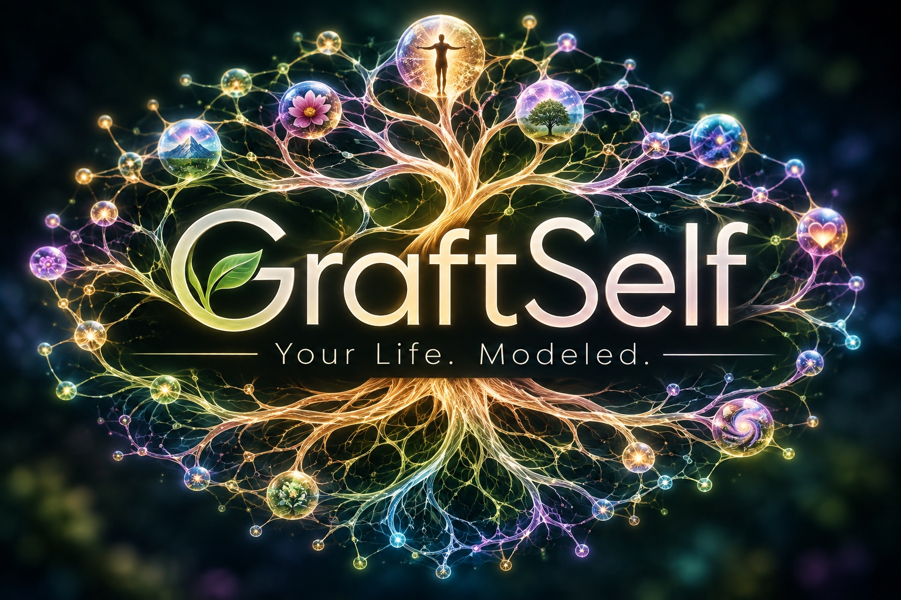

# GraftSelf

**Your Life. Modeled.**

Not trained on everyone. Grafted from you.

A graftself is a personal AI grafted from one person's life. It learns from what you wrote, gets shaped by what you corrected, runs on hardware you own, and grows a new ring every week.

## Why

Every big model knows everything and no one. Every chat starts from zero, and the same model is rented to everyone.

Coast redwood roots run shallow, but they spread wide and graft into their neighbors' roots until a grove stands like one living thing. A graftself works the same way. It grafts onto your life until the two of you share one root system.

Read the full idea in [PHILOSOPHY.md](PHILOSOPHY.md).

## How it grows

1. **Base model.** An open-weight model that runs locally at full precision and can see images.
2. **Your voice in the weights.** A small adapter is trained only on things you actually wrote, so it learns how you talk to each kind of person: customers, partners, friends, the public. Nothing written by someone else is ever a training target, not even another AI.
3. **Facts in a library, not in the weights.** What it knows about your world lives in a private index it looks up and cites, so facts stay current and checkable.
4. **Your judgment.** Every time you pick your real reply over its draft, that choice teaches it what you would and wouldn't say.
5. **Eyes, ears and voice.** Seeing, hearing and speaking start as separate local parts and join the core over time.

Every week it retrains on what's new. A new version replaces the old one only if it scores better on blind tests about you, so it can grow but never drift.

## Private by design

Your graftself never leaves your machines. Private conversations with family stay out of training entirely; they're only there to look things up. What this project shares is the recipe and the tools, so anyone can grow their own. Nobody's personal weights or data are ever published here.

## For robots

A robot with a graftself inside it isn't a generic machine. It knows its owner: your space, your habits, how you like things done, and what you'd never want. Graftself aims to be that brain layer.

## Status

The first graftself is training now on a single Mac. Getting there meant writing our own GPU training code for the base model's newer attention layers, which cut training time from days to hours. Next comes a blind test: its replies against the real ones, side by side, to see if it actually sounds like the person.
